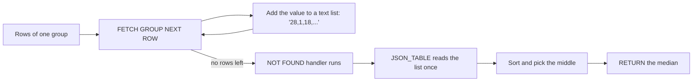
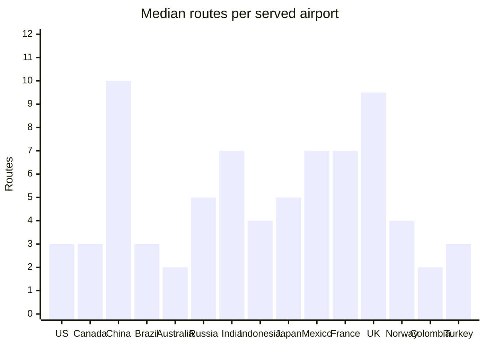
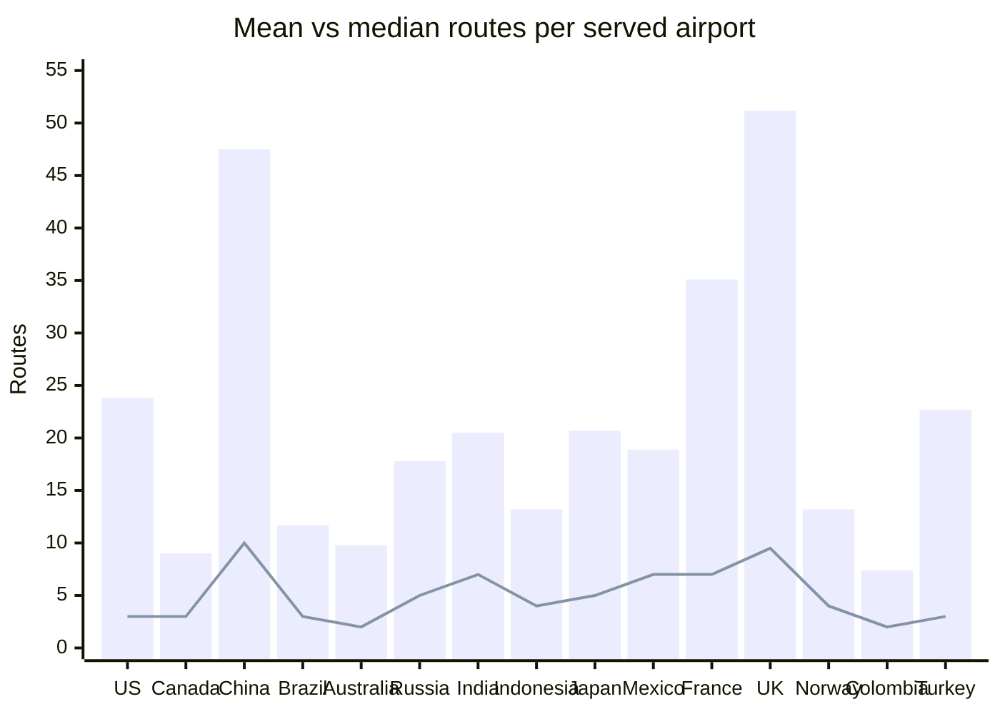
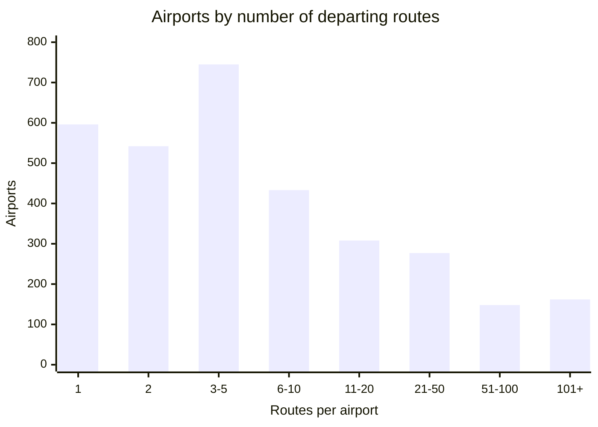
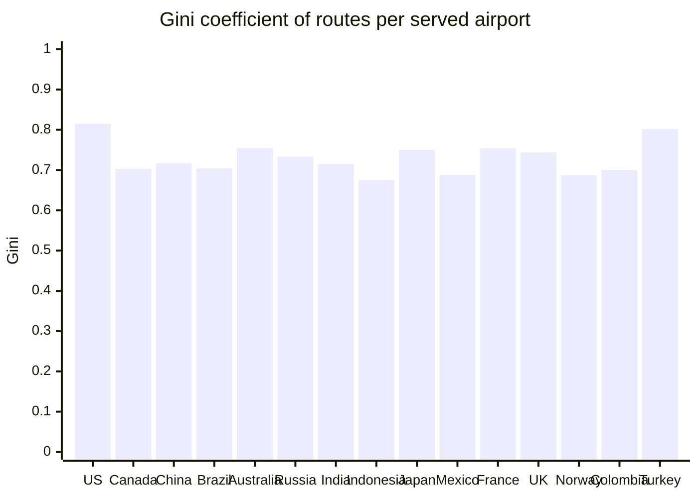
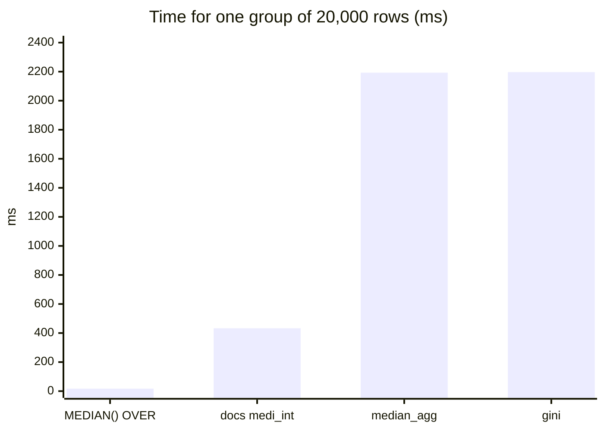

A project for area 2, "Custom aggregate functions in SQL" for the [MariaDB student database projects, 2026-09](https://mariadb.org/bachelor_hackathon_2026-09/).

# Custom aggregate functions in MariaDB

Four aggregate functions written in plain SQL, used on real flight data: `median_agg`, `gini`, `mode_agg` and `wpercentile`.

[](LICENSE)
[](https://mariadb.org/)
[](#tests)
[](https://github.com/ayoublabrinssi/Capstone-Starter-MariaDB-custom-aggregates/actions/workflows/tests.yml)
[](CONTRIBUTING.md)

MariaDB lets you write your own aggregate function in SQL with `CREATE AGGREGATE FUNCTION` and `FETCH GROUP NEXT ROW`. MySQL has no SQL-level equivalent: there you write a C UDF or do without. This repo builds four aggregates, runs them on the [openflights](https://github.com/mariadb/openflights) data, compares each one with the query you would write without it, and tests where they break.

> **Status:** a student project, tested on MariaDB 12.3.3 only. Fine for learning and analysis, not tested for production use.

## Contents

- [The functions](#the-functions)
- [Quick start](#quick-start)
- [Use them on your own table](#use-them-on-your-own-table)
- [Install in your own database](#install-in-your-own-database)
- [How it works](#how-it-works)
- [Findings](#findings)
- [Before and after](#before-and-after)
- [Past the docs: what we tested](#past-the-docs-what-we-tested)
- [Tests](#tests)
- [Speed](#speed)
- [Run the experiments again](#run-the-experiments-again)
- [When not to use a custom aggregate](#when-not-to-use-a-custom-aggregate)
- [Project structure](#project-structure)
- [Contributing](#contributing)
- [Team](#team)
- [License and credits](#license-and-credits)

## The functions

| Function | Returns | Question it answers on openflights | Source |
|---|---|---|---|
| `median_agg(x)` | the middle value (mean of the two middle values for an even count) | What is the typical number of routes per airport in a country? | [sql/02_median_agg.sql](sql/02_median_agg.sql) |
| `gini(x)` | 0 (all equal) to 1 (one row holds everything) | How concentrated are a country's routes in a few airports? | [sql/03_gini.sql](sql/03_gini.sql) |
| `mode_agg(x)` | the most common value, works on text | Which airline runs the most routes from each country? | [sql/04_mode_agg.sql](sql/04_mode_agg.sql) |
| `wpercentile(x, w, p)` | the weighted p-th percentile: each row counts `w` times, `p` from 0 to 1 | How big is the airport a typical *route* leaves from, not the typical airport? | [sql/05_wpercentile.sql](sql/05_wpercentile.sql) |

All four skip NULLs and return NULL for an empty group, like `AVG()`.

## Quick start

**Requirements:** Docker with Compose (tested with Colima on an Intel Mac and on GitHub Actions) and MariaDB 12.3.3, the version all results come from.

1. Start MariaDB with the openflights data:

   ```sh
   git clone https://github.com/mariadb/openflights.git
   cd openflights
   MARIADB_VERSION=12.3.3 docker compose up --wait
   cd ..
   ```

   Without `MARIADB_VERSION` the compose file uses the `mariadb:lts` image, which can be a newer version.

2. From this repo's folder, install the view and the four functions, then run the tests:

   ```sh
   scripts/install.sh
   scripts/test.sh
   ```

3. Run a query, or open a prompt and type your own:

   ```sh
   scripts/db.sh < queries/median/after.sql
   scripts/db.sh
   ```

`scripts/db.sh` runs the mariadb client inside the openflights container and reads the root password there, from the container's `MARIADB_ROOT_PASSWORD`. So no password is written in this repo. The other scripts in `scripts/` all go through it.

## Use them on your own table

After `scripts/install.sh` the functions work on any table in `flightdb2`:

```sql
CREATE TABLE grades (course VARCHAR(20), student VARCHAR(20), grade DOUBLE, letter CHAR(1));
INSERT INTO grades VALUES
  ('SQL', 'Ana', 1.3, 'A'), ('SQL', 'Ben', 2.7, 'B'), ('SQL', 'Cem', 1.0, 'A'),
  ('Java', 'Ana', 3.3, 'B'), ('Java', 'Ben', 2.0, 'B'), ('Java', 'Cem', 4.0, 'D');

SELECT course,
       median_agg(grade) AS median_grade,
       gini(grade)       AS spread,
       mode_agg(letter)  AS most_common_letter
FROM grades
GROUP BY course;
```

| course | median_grade | spread | most_common_letter |
|---|---|---|---|
| Java | 3.3 | 0.143 | B |
| SQL | 1.3 | 0.227 | A |

Use them like `AVG()` or `COUNT()`: in a `SELECT` with `GROUP BY`. They do not work with `OVER`, `DISTINCT` or directly in `HAVING` (see [what works and what does not](#what-works-and-what-does-not)).

## Install in your own database

The functions do not need Docker or openflights. Each one is a single file in `sql/`. Load them with the mariadb client into any database:

```sh
cat sql/02_median_agg.sql sql/03_gini.sql sql/04_mode_agg.sql sql/05_wpercentile.sql | mariadb -u youruser -p yourdb
```

Or load only the one you need. `sql/01_served_airports.sql` is the openflights view, so leave it out. The functions use `JSON_TABLE`, so they need MariaDB 10.6 or newer. We tested them on 12.3.3 only.

If the server has binary logging on, which replication and point-in-time backups need, the user who loads the functions needs the SUPER privilege. Without it MariaDB stops with `ERROR 1419`, until an admin sets `log_bin_trust_function_creators = 1`. The functions are declared `DETERMINISTIC`, because without it the server refuses them even for root ([experiments/11](experiments/11_binary_log.sh)).

## How it works

MariaDB hands a stored aggregate one row at a time. All four functions follow the same pattern: collect the values of the group in a text list, then compute the answer once when the group ends.



This is `median_agg` from [sql/02_median_agg.sql](sql/02_median_agg.sql):

```sql
CREATE OR REPLACE AGGREGATE FUNCTION median_agg(x DOUBLE) RETURNS DOUBLE DETERMINISTIC
BEGIN
  DECLARE vals LONGTEXT DEFAULT '';  -- the group's values, comma-separated
  DECLARE n INT DEFAULT 0;           -- how many values so far

  -- Runs once, when the group has no more rows.
  DECLARE CONTINUE HANDLER FOR NOT FOUND
  BEGIN
    DECLARE take INT DEFAULT 2 - n % 2;      -- odd n: 1 middle value, even n: 2
    DECLARE skip INT DEFAULT (n - 1) DIV 2;  -- values below the middle
    RETURN (
      SELECT AVG(v) FROM (
        SELECT jt.v
        FROM JSON_TABLE(CONCAT('[', vals, ']'), '$[*]' COLUMNS (v DOUBLE PATH '$')) AS jt
        ORDER BY jt.v
        LIMIT take OFFSET skip
      ) AS middle
    );
  END;

  -- Runs once per row.
  LOOP
    FETCH GROUP NEXT ROW;
    IF x IS NOT NULL THEN
      SET vals = CONCAT(vals, IF(n = 0, '', ','), x);
      SET n = n + 1;
    END IF;
  END LOOP;
END
```

- The handler is written at the top but runs at the end, when `FETCH GROUP NEXT ROW` finds no more rows.
- `DETERMINISTIC` says the same values always give the same answer. A server with binary logging refuses a function without it.
- `gini` uses the same loop and keeps a running total. At the end it ranks the values with `ROW_NUMBER()` and applies `G = 2 * SUM(rank * x) / (n * total) - (n + 1) / n`.
- `mode_agg` wraps each value with `JSON_QUOTE`, so commas and quotes inside a name do not break the list. At the end it groups the values and returns the most common one. Ties go to the smallest value, so the result is always the same.
- `wpercentile` stores `[value, weight]` pairs instead of single values. At the end it sorts by value, keeps a running total of the weights, and returns the first value where that total reaches `p` times the sum of all weights.

**Data model.** The functions run on one view, `served_airports` ([sql/01_served_airports.sql](sql/01_served_airports.sql)): one row per airport with at least one departing route, with `apid`, `name`, `country` and `routes`. Airports with no routes are left out. Most of them are small airfields, and counting them as zeros would hide the shape of real traffic. The openflights tables `airports`, `routes` and `airlines` are not changed.

## Findings

Data: 3,211 airports with at least one departing route. The world mean is 20.9 routes per airport, the median is 4 and the maximum is 915.

- **Most airports are small.** 1,883 of 3,211 (59%) have 5 routes or fewer, while 162 hubs have more than 100.
- **So the mean is misleading.** In the US the mean is 23.8 routes per airport but the median is 3. A few hubs pull the mean up. A median gives the typical airport.
- **`gini` puts a number on that concentration.** World value: 0.776. Among the 15 biggest countries the US is the most concentrated (0.815) and Indonesia the least (0.675).
- **The top airline is often not the national one.** Ryanair is on top in 7 countries, including the UK, Spain and Italy. Ethiopian Airlines is on top in 9 countries, 8 of them outside Ethiopia (Benin, Chad, Gabon, Guinea, Malawi, Mali, Niger, Togo). In Morocco it is Royal Air Maroc, with 117 of 310 routes.
- **The typical airport and the typical route tell different stories.** The median US airport has 3 routes, but half of all US departures leave from airports with 196 routes or more (`wpercentile(routes, routes, 0.5)`). Turkey shows the biggest jump in the top 15: 3 against 145. Canada and Brazil the smallest: 3 against 43 and 36. The gap is another way to see hub concentration, in the same unit as the data (routes), where `gini` gives a number from 0 to 1.

### Median routes per airport, top 15 countries



### Mean (bars) vs median (line)



The gap between a bar and the line shows how much a few big hubs distort the mean.

### How many routes airports have (whole world)



### Gini of routes per airport, top 15 countries



Countries are the 15 with the most served airports, from left to right. All chart numbers come from [queries/chart_data.sql](queries/chart_data.sql).

## Before and after

Each function comes with the query you would write without it, the query with it, and a check that both give the same answer.

| Question | Without the custom aggregate | With it | Check (0 rows = same answer for every country) |
|---|---|---|---|
| Median routes per airport, per country | [median/before.sql](queries/median/before.sql) | [median/after.sql](queries/median/after.sql) | [median/check.sql](queries/median/check.sql) |
| Gini of routes per airport, per country | [gini/before.sql](queries/gini/before.sql) | [gini/after.sql](queries/gini/after.sql) | [gini/check.sql](queries/gini/check.sql) |
| Top airline per country | [mode/before.sql](queries/mode/before.sql) | [mode/after.sql](queries/mode/after.sql) | [mode/check.sql](queries/mode/check.sql) |
| Route-weighted median airport size, per country | [wpercentile/before.sql](queries/wpercentile/before.sql) | [wpercentile/after.sql](queries/wpercentile/after.sql) | [wpercentile/check.sql](queries/wpercentile/check.sql) (at p = 0.1, 0.5 and 0.9) |

For example, the top airline per country (shortened from the files) without `mode_agg` needs a count, a rank and a filter:

```sql
SELECT country, airline, routes
FROM (
  SELECT a.country, al.name AS airline, COUNT(*) AS routes,
         ROW_NUMBER() OVER (PARTITION BY a.country ORDER BY COUNT(*) DESC, al.name) AS rn
  FROM routes r
  JOIN airports a ON a.apid = r.src_apid
  JOIN airlines al ON al.alid = r.alid
  GROUP BY a.country, al.name
) AS ranked
WHERE rn = 1;
```

With it, one call:

```sql
SELECT a.country, mode_agg(al.name) AS top_airline
FROM routes r
JOIN airports a ON a.apid = r.src_apid
JOIN airlines al ON al.alid = r.alid
GROUP BY a.country;
```

### Length and time, with and without

Lines and words count the SQL in the `queries/` files, without comments ([results/09_query_length.txt](results/09_query_length.txt)). Times are for the whole data set (every country), 10 runs each: the median, with the fastest and slowest run. They come from [experiments/09_before_after.sql](experiments/09_before_after.sql), on the Intel Mac described under [Speed](#speed) ([results/09_before_after.txt](results/09_before_after.txt)).

| Function | Lines, without → with | Words, without → with | Time without | Time with |
|---|---|---|---|---|
| `median_agg` | 7 → 7 | 26 → 20 | 560 ms (404 to 695) | 368 ms (315 to 549) |
| `gini` | 12 → 7 | 56 → 20 | 351 ms (330 to 468) | 366 ms (200 to 429) |
| `mode_agg` | 12 → 9 | 60 → 34 | 364 ms (354 to 500) | 4,455 ms (4,266 to 8,869) |
| `wpercentile` | 15 → 8 | 61 → 25 | 392 ms (352 to 866) | 397 ms (254 to 526) |

What this shows:

- **Shorter and flatter.** With the custom aggregate there is no subquery, no window function and no `DISTINCT`, and `gini` no longer needs the DOUBLE casts.
- **About the same time for median, Gini and the weighted median.** Most of the time goes into the `served_airports` view, which both versions read, and no group is bigger than 550 airports. `median_agg` is even a bit faster than `MEDIAN() OVER`, which computes a value for every airport and then needs `DISTINCT`.
- **`mode_agg` is about 12 times slower.** It reads all 67,663 routes, and the US group alone has 13,056 rows. Big groups are where the text list gets slow (see [Speed](#speed)).

### A trap found on the way

The first hand-written Gini query and the first `gini` function both returned slightly wrong numbers, for example `0.000000000333` instead of `0` for three equal values. The cause: in MariaDB, `INT / INT` is computed as DECIMAL and kept to `div_precision_increment` decimals (default 4), so `(n + 1) / n` became `1.3333`. Both versions now cast to DOUBLE. The function fixes this in one place; every hand-written copy of the formula has to remember it.

## Past the docs: what we tested

The MariaDB docs show how to write a stored aggregate, with a median example, but say little about where it breaks. Each experiment below is a file in [experiments/](experiments/), and its output is saved in [results/](results/). All runs are on MariaDB 12.3.3.

### The docs' median vs ours

The docs' example (`medi_int`, copied as written in [experiments/01_docs_median.sql](experiments/01_docs_median.sql)) stores the group in a temporary table `tt`. Ours stores it in a variable.

| Case | Docs `medi_int` | Our `median_agg` |
|---|---|---|
| Median of every country | same as ours (0 differences) | same as built-in `MEDIAN()` |
| `(5, NULL, 1)` | 1 (wrong: the NULL is stored and sorts first) | 3 |
| `(1.5, 2.5)` | 2.5 (wrong: the INT parameter rounds the inputs to 2 and 3) | 2 |
| Called twice in one SELECT | `ERROR 1050 Table 'tt' already exists` | works |
| Next call after that error | fails too: `tt` was left behind | works |
| Group of 20,000 rows | 433 ms | 2,193 ms |

The clash is a known server issue: [MDEV-17246](https://jira.mariadb.org/browse/MDEV-17246) "Stored Functions need their own temporary table namespace" (open). So the docs' version is faster on big groups but cannot be used twice in one query. Ours is safe to combine, but slower on big groups (see [Speed](#speed)).

### What works and what does not

| Use | Works? | Notes |
|---|---|---|
| As a window function, `median_agg(x) OVER (...)` | no, `ERROR 1064` | Stored aggregates cannot be window functions. Tracked in [MDEV-11263](https://jira.mariadb.org/browse/MDEV-11263) (stalled). Use the built-in `MEDIAN() OVER` instead. |
| `median_agg(DISTINCT x)` | no, `ERROR 1064` | Workaround: `SELECT median_agg(r) FROM (SELECT DISTINCT routes AS r ...) d` |
| In `HAVING`, e.g. `HAVING gini(routes) > 0.8` | no, `ERROR 1054 Unknown column 'routes' in 'HAVING'` | Built-in `SUM` and `AVG` work there. Same error on a plain table with 2 columns. Workarounds: use the alias (`HAVING g > 0.8`) or a derived table. We found no JIRA issue for this (searched 11 Oct 2026). |
| In `ORDER BY` | yes | |
| `WITH ROLLUP` | yes | Germany 22.5, Morocco 11, total 18 |
| Two custom aggregates in one SELECT | yes | |
| Inside a view definition | yes | [MDEV-28475](https://jira.mariadb.org/browse/MDEV-28475) did not show up here ([experiments/03](experiments/03_view_subquery.sql)) |
| In a correlated subquery | yes | 0 differences against GROUP BY for every country ([MDEV-21161](https://jira.mariadb.org/browse/MDEV-21161) did not show up here) |
| Empty group | returns NULL | Right for a median. A custom count would also return NULL, not 0: [MDEV-24580](https://jira.mariadb.org/browse/MDEV-24580) |
| Text input, `median_agg(name)` | no, `ERROR 1366` | in strict mode, which is the default |
| Oracle syntax (`sql_mode=ORACLE`) | yes | The docs' SQL/PL example (`RETURN`, `EXCEPTION WHEN NO_DATA_FOUND`) works. Our functions, created in the default mode, give the same answers when called from an ORACLE-mode session, because each routine keeps the `sql_mode` it was created in ([experiments/10](experiments/10_oracle_mode.sql)) |
| On a server with binary logging (`--log-bin`) | yes, because they are declared `DETERMINISTIC` | Without it: `ERROR 1418`, even for root. A user without SUPER gets `ERROR 1419` until `log_bin_trust_function_creators = 1` ([experiments/11](experiments/11_binary_log.sh)) |
| Listing your aggregates | only in `mysql.proc` | `mysql.proc.aggregate` is `GROUP` for a stored aggregate. `information_schema.ROUTINES` has no column for it, so there an aggregate looks like any other function ([experiments/10](experiments/10_oracle_mode.sql)) |

## Tests

```sh
scripts/test.sh
```

[tests/edge_cases.sql](tests/edge_cases.sql) has 41 edge-case tests: odd and even counts, NULLs, negatives, decimals, empty groups, Gini of equal values, ties, text with commas and quotes, Arabic text, a `ROLLUP` total, and for `wpercentile` zero and negative weights, `p` at 0, 1 and out of range. `scripts/test.sh` also runs the 4 check queries on the whole data set. It prints one line per test, shows what a failing test got and expected, and exits with 1 if anything fails. The same steps run on GitHub Actions with MariaDB 12.3.3 on every push and pull request ([.github/workflows/tests.yml](.github/workflows/tests.yml)):
```text
ok    median: odd count
ok    median: even count
...
ok    mode: top airline, Morocco
ok    queries/median/check.sql
ok    queries/gini/check.sql
ok    queries/mode/check.sql
ok    queries/wpercentile/check.sql
All tests passed.
```

## Speed

[experiments/04_scale.sql](experiments/04_scale.sql) times each function on one group of n generated rows (Sequence engine, same values every run). Each size is run 10 times. The table shows the median time, with the fastest and slowest run for 10,000 rows. Full output: [results/04_scale.txt](results/04_scale.txt).

| Rows in the group | `AVG` (baseline) | built-in `MEDIAN() OVER` | docs `medi_int` | `median_agg` | `gini` | first `median_agg` (JSON) |
|---|---|---|---|---|---|---|
| 100 | 0.2 ms | 0.3 ms | 2.6 ms | 1.2 ms | 1.2 ms | 2.6 ms |
| 1,000 | 0.4 ms | 0.9 ms | 21 ms | 15 ms | 16 ms | 106 ms |
| 5,000 | 1.9 ms | 4.5 ms | 119 ms | 167 ms | 178 ms | 2,792 ms |
| 10,000 | 3.8 ms | 8.2 ms | 205 ms (198 to 317) | 614 ms (572 to 714) | 603 ms (574 to 755) | 10,271 ms (9,954 to 14,802) |
| 20,000 | 6.3 ms | 17 ms | 433 ms | 2,193 ms | 2,197 ms | not run |

Machine: Intel Mac (2017), MariaDB in Colima (2 CPUs, 4 GB).



What this shows:

- **Our first version was very slow on big groups.** It used `JSON_ARRAY_APPEND` for every row, which reads and copies the whole array each time: 10 s for 10,000 rows. Keeping the values in a plain text list and reading it as JSON once at the end gives the same results 17 times faster (614 ms). The old version is kept in [experiments/05_faster_median.sql](experiments/05_faster_median.sql) and checked against the new one.
- **The cost still grows faster than the group.** Doubling the rows from 10,000 to 20,000 makes `median_agg` about 3.6 times slower, because the text list is copied as it grows. The docs' temp-table version grows in line with the rows.
- **On one big group, the built-in is far faster.** `MEDIAN() OVER` is about 125 times faster than `median_agg` at 20,000 rows. On many small groups the gap is small and can even turn around (experiment 8, below).
- **`mode_agg` hits the same wall on real data.** Top airline per country over all 67,663 routes takes 5.2 s with `mode_agg` and 0.44 s with the hand-written `ROW_NUMBER()` query (10 runs, [results/06_mode_timing.txt](results/06_mode_timing.txt)). Most of that time is the US group, which has 13,056 routes.
- **`wpercentile` is close to the window-function query on small groups, about twice as slow on big ones.** Route-weighted median per country on the 3,211 airports: 236 ms against 192 ms. The same median with one row per route (67,663 rows, US group 13,056): 1.7 s against 0.82 s, because of the same growing text list. Both versions give the same answer for every country. 10 runs each, on a Windows laptop (Ryzen 5 5500U, 8 GB RAM) with Docker Desktop, [experiments/07_wpercentile_timing.sql](experiments/07_wpercentile_timing.sql), output in [results/07_wpercentile_timing.txt](results/07_wpercentile_timing.txt).
- **Against the built-in, there is no clear winner in a GROUP BY query.** MariaDB has no built-in weighted percentile, but with every weight = 1 `wpercentile(x, 1, p)` gives the same answer as the built-in `PERCENTILE_DISC(p)` (0 differences for every country). 90th percentile per country: 211 ms against 247 ms on the 3,211 airports, 1.7 s against 1.8 s on the 67,663 routes. The built-in is only a window function, so it computes a value for every row and needs `DISTINCT` to fold them back to one per country, and most of the time goes into the view and the join, which both pay. This does not mean the custom aggregate is faster in general: on one large group of plain numbers the built-in `MEDIAN()` is about 125 times faster (experiment 4). 10 runs each, [experiments/08_wpercentile_vs_builtin.sql](experiments/08_wpercentile_vs_builtin.sql), output in [results/08_wpercentile_vs_builtin.txt](results/08_wpercentile_vs_builtin.txt).
- **On openflights the median and Gini are fast enough.** The biggest group is the US with 550 airports, and `median_agg` plus `gini` over all 225 countries take about 0.5 s.

One timing run first came out negative (the VM clock was corrected while it ran), so that size was run again.

## Run the experiments again

```sh
scripts/run_experiments.sh my-run
```

This runs all 11 experiments and saves their output in `my-run/`, next to `results/`, so you can compare. It takes about 10 minutes. Without a folder name it overwrites `results/`. Times change from machine to machine, so compare the ratios: for example `median_agg` against the old JSON version, or `mode_agg` against the `ROW_NUMBER()` query.

A full rerun on the Intel Mac on 16 Oct 2026 is saved in [results/rerun-2026-10-16/](results/rerun-2026-10-16/). The milliseconds moved a little, the findings did not:

- `median_agg` against the old JSON version at 10,000 rows: 17.5 times faster (17 in `results/`).
- `MEDIAN() OVER` against `median_agg` at 20,000 rows: 120 times faster (125 in `results/`).
- Experiments 7 and 8 were first run on Shreyash's Windows laptop. On the Mac they give the same order: `wpercentile` is close to the window query on the 3,211 airports and slower on the 67,663 routes, and a little faster than `PERCENTILE_DISC` on both.

## When not to use a custom aggregate

- **When a built-in does the job.** For a median use `MEDIAN()` or `PERCENTILE_CONT()` as window functions. They are far faster.
- **On big groups**, with tens of thousands of rows in one group. A stored aggregate that keeps every value gets slow. Pre-aggregate, or use a built-in.
- **When you need it as a window function, with DISTINCT, or directly in HAVING.** None of these work (see the table above).
- **When the function needs a temporary table** and may be called twice in one query. Keep state in variables instead.

Use one when there is no built-in (like Gini), when the formula is easy to get wrong by hand (see the DECIMAL trap above), and when the same logic is reused in many queries.

### Other databases

- **PostgreSQL** has `CREATE AGGREGATE` with a state function and a final function, written in SQL or PL/pgSQL. It can be used as a window function.
- **MySQL** has no SQL-level aggregates. You write a C UDF.
- **MariaDB 13.2** is adding a C plugin interface for aggregates: [MDEV-40672](https://jira.mariadb.org/browse/MDEV-40672) "Pluggable aggregate functions" (in testing on 11 Oct 2026). That is for C code; this project stays in SQL.

## Project structure

```text
.
├── sql/            the view and the four functions (installed by scripts/install.sh)
├── queries/        one folder per function with before.sql, after.sql and check.sql, plus the chart data
├── tests/          edge-case tests (run by scripts/test.sh)
├── experiments/    the experiments behind "Past the docs" and "Speed"
├── results/        the saved output of each experiment
├── scripts/        db.sh opens the mariadb client; install.sh, test.sh and run_experiments.sh use it
├── docs/           AI-log.md, every AI use and its prompt; SELF-ASSESSMENT.md, what each of us did, week by week
├── .github/        issue and PR templates, and the workflow that runs the tests
├── CONTRIBUTING.md how to report a bug, suggest a feature or add a function
└── CODE_OF_CONDUCT.md
```

## Contributing

Contributions are welcome, small ones too. Good places to start:

- a new aggregate, for example a percentile or a weighted average,
- more edge cases in [tests/edge_cases.sql](tests/edge_cases.sql),
- results on other MariaDB versions,
- fixes to this README.

Read [CONTRIBUTING.md](CONTRIBUTING.md) for how to report a bug, suggest a feature and open a pull request. This project follows the [Contributor Covenant code of conduct](CODE_OF_CONDUCT.md). Questions go in an [issue](https://github.com/ayoublabrinssi/Capstone-Starter-MariaDB-custom-aggregates/issues).

## Team

Team IV, Capstone Project I (CAP-01), Constructor University, fall 2026.

| Who | GitHub | Did |
|---|---|---|
| Ayoub Labrinssi | [@ayoublabrinssi](https://github.com/ayoublabrinssi) | `median_agg`, `gini`, `mode_agg`, setup and scripts, experiments 1 to 6 and 9 to 11, README |
| Shreyash Hadiya | [@Shreyashahir](https://github.com/Shreyashahir) | `wpercentile`, its 14 tests, experiments 7 and 8 |

Every change went through a branch and a pull request. Who did what each week is in [docs/SELF-ASSESSMENT.md](docs/SELF-ASSESSMENT.md), and every AI use is in [docs/AI-log.md](docs/AI-log.md).

## License and credits

- Code: [MIT License](LICENSE).
- Data: [OpenFlights](https://openflights.org/data.html), loaded with [mariadb/openflights](https://github.com/mariadb/openflights).
